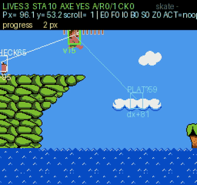
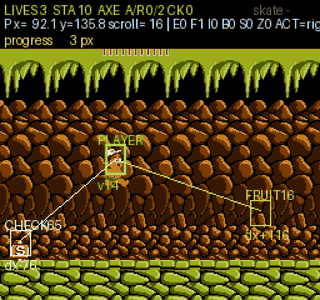
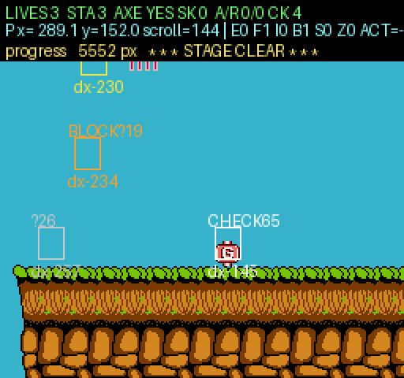
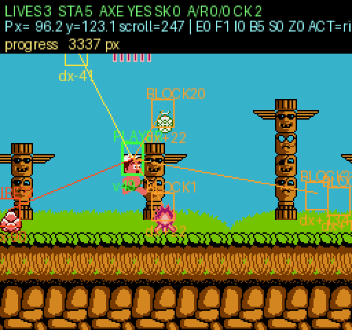
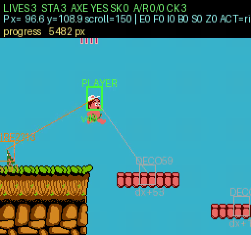

# adventure-island-ai

用**纯 CPU 的 PPO** 训练 AI 玩通 FC《冒险岛》（Adventure Island, NES）**第一关（Round 1-1）、第二关（Round 1-2）与第三关（Round 1-3）**。

技术栈：[cynes](https://github.com/Youlixx/cynes) NES 模拟器（可读 RAM）+ 手动逆向的游戏内存地图 + 自研 Gym 风格环境。观测把 **CNN 视觉特征**（80×86 灰度帧堆叠）与 **RAM 数值特征**融合——因为平台、坑、悬崖这些地形信息只存在于像素里，纯 RAM 观测的 agent 永远学不会跳。

第一关模型（`runs/ppo_v10/ppo_final.pt`，1500 万 env steps）**8/8 局稳定通关 Round 1-1**，每局约 80 秒游戏时间，最远推进 5776 px。

第二关模型（`models/ppo_1-2_clear_8M.pt`，800 万 env steps，1-2/1-1 混合课程）**已拿下 Round 1-2**：原生环境实测平均推进 5961 px、12 局 8 局跑满全程，无头评估 12 局 4 局真正通关（关卡全长约 6800 px）。下面是它的一次完整通关实录（带实时标注，右侧说明见 [历史记录/第二关训练曲折史.md](历史记录/第二关训练曲折史.md)）。

<p align="center">
  
</p>

第三关模型（`models/ppo_1-3_clear_16M.pt`，累计 16,005,120 env steps，1-3 为主课程）**已拿下 Round 1-3**：greedy 实测 16 局 2 局真正通关（通关那局推进 6536 / 6804 px），平均 6272 px。下面是它的一次完整通关实录（带实时标注 + jsnes 还原的原版 BGM）。

<p align="center">
  
  <br/>
  <em>完整通关录像（含 jsnes 还原的原版 BGM）：</em>
  <a href="videos/1-3_clear_player.mp4">玩家视角 mp4（768×720，带标注）</a>
  · <a href="videos/1-3_clear_agent.mp4">agent 视角 mp4（马赛克）</a>
</p>

## 成果

| 指标 | 数值 |
|------|------|
| 训练量 | 15,000,576 env steps（92.9 分钟，8 个 CPU 工作进程） |
| 通关率 | **8 / 8**（贪心策略，单命，从开局到通关旗） |
| 通关推进距离 | 5296 – 5776 px（约 21–23 屏） |
| 单局时长 | 76 – 82 秒游戏时间 |
| 动作空间 | 10 个离散动作 |
| 观测 | 37 维 RAM 向量 + 80×86×2 灰度帧堆叠 |

### 第二关（Round 1-2，8M 步）

| 指标 | 数值 |
|------|------|
| 训练量 | 8,005,632 env steps（124.5 分钟，48 个 CPU 工作进程） |
| 课程 | `--stages "1-2:0.7,1-1:0.3"` 混合采样，开局预装备斧头 |
| 原生环境实测 | 平均推进 **5961 px**，12 局 8 局跑满 6500+ px（关卡全长 ~6800 px） |
| 无头评估 | 12 局 **4 局真正通关**，其余多死在 5186 px（终点前最后一处） |
| 观测 | 69 维 RAM 向量（含 32 关 one-hot）+ 80×86×2 灰度帧堆叠 |
| 模型 | `models/ppo_1-2_clear_8M.pt`（回放需 `--stage-idx 0`，见历史记录） |

### 第三关（Round 1-3，累计 16M 步）

| 指标 | 数值 |
|------|------|
| 训练量 | 16,005,120 env steps（首轮 8M + 续训 8M，各约 125 分钟，48 个 CPU 工作进程） |
| 课程 | 首轮 `--stages "1-3:0.6,1-2:0.3,1-1:0.1"`，续训 `"1-3:0.8,1-2:0.15,1-1:0.05"`，开局预装备斧头 |
| 实测通关 | greedy **16 局 2 局真正通关**（推进 6536 / 6804 px），平均 6272 px |
| 观测 | 71 维 RAM 向量（32 关 one-hot + 火焰弹位 + 无敌位）+ 80×86×2 灰度帧堆叠 |
| 模型 | [`models/ppo_1-3_clear_16M.pt`](models/ppo_1-3_clear_16M.pt)（回放需 `--start-round 2 --stage-idx 2`） |

> ⚠️ **评估起点的坑**：`--start-round 2`（和训练一致的开机起点）能测出通关，
> 用 `saves/stages/stage_1-3.state` 起点测 12 局 0 通关（最好 6607 px）——同一份权重两种结论。
> 详见 [历史记录](历史记录/第二关训练曲折史.md)。

<p align="center">
  
  
</p>

<p align="center">
  <em>最后冲刺 → 撞线通关 → 通关谢幕（GIF 自动播放）</em><br/>
  
</p>

<p align="center">
  <video src="https://github.com/user-attachments/assets/9ad9bf77-fe2f-4991-b460-e1fe2591f353" controls width="60%" poster="docs/images/stage_clear.png"></video>
</p>

## 快速开始

```sh
pip install -r requirements.txt
```

**ROM 不随仓库分发**（版权原因）。请自备 `Adventure Island (USA).nes`：

```sh
# 方式一：放到 roms/ 目录（默认路径）
# 方式二：环境变量指定
set AI_ROM=D:\path\to\Adventure Island (USA).nes          # Windows
export AI_ROM="/path/to/Adventure Island (USA).nes"       # Linux/macOS
```

```sh
# 观看已训练模型通关第一关（会开游戏窗口）
python enjoy.py runs/ppo_v10/ppo_final.pt --deterministic

# 观看第二关模型（必须从 1-2 存档起步、one-hot 显式给 0——
# 该检查点训练时的关卡顺序与文件名推断相反，原因见 历史记录/第二关训练曲折史.md 第 8 节）
python visualize.py models/ppo_1-2_clear_8M.pt \
    --start-state saves/stages/stage_1-2.state --stage-idx 0

# 观看第三关模型（用 --start-round 2 开机起步，别用 stage_1-3.state：
# 后者测出来是 0/12 通关，同一份权重两种结论）
python visualize.py models/ppo_1-3_clear_16M.pt \
    --start-round 2 --stage-idx 2

# 无头评估：N 局贪心策略 —— 用 eval_native.py（真训练 env），
# evaluate.py 的观测 shim 已随观测扩维漂移，数字不可信
python tools/eval_native.py models/ppo_1-3_clear_16M.pt \
    --start-round 2 --stage-idx 2 --episodes 16 --clear-ends-episode

# 自己训练（CPU，8 并行环境）
python train.py --timesteps 15000000 --save-dir runs/my_run

# 录制通关视频（多局中通关者胜出，否则保留最远的一局）
python tools/record_clear.py runs/ppo_v10/ppo_final.pt
```

训练曲线：`runs/ppo_v10/progress.csv`（update / env_steps / mean_reward / mean_x_progress / episodes / losses / entropy / fps）。

## 方法

### 观测：37 维 RAM + 80×86 灰度帧堆叠

| 分支 | 内容 |
|------|------|
| RAM（37 维） | 玩家 x/y/vx/gravity/体力/武器（8）+ 最近 4 个对象槽的相对位置/速度/类型（16）+ 生命/关卡进度（4）+ 最近敌人/水果 dx,dy,seen（6）+ 最近道具（斧头！）dx,dy,seen（3） |
| 视觉（2×80×86） | 256×240 RGB 每 3 像素抽样灰度化；连续 2 个决策帧堆叠，让网络能判断物体运动方向 |

网络：`Conv2d(2→16, k8 s4) → ReLU → Conv2d(16→32, k4 s2) → ReLU → Flatten`，与 RAM 向量拼接后过 `Linear(2341→128) → LayerNorm → ReLU`，分别输出策略（10）和价值（1）头。

> **为什么必须有像素分支**：RAM 里没有任何地形表达——平台、坑、悬崖都只存在于显存里。纯 RAM 模型（`runs/ppo_ram_only_final`）训练 50 万步后平均只推进 871 px 就卡住。加上 CNN 分支后策略才学会起跳。

> **LayerNorm 是必需的**：融合层最初用 `Linear + Tanh`，实测预激活 |x|≈5.8，98–100% 单元饱和在 ±1，整个网络退化成符号函数——蜗牛从 210 px 爬到 30 px，logits 只动 0.001。换成 LayerNorm + ReLU 后信号才活过来（`tools/probe_tanh_sat.py`）。

### 动作（10 个离散）

`noop / right / left / jump / right+jump / left+jump / throw / right+throw / jump+throw / right+jump+throw`

最后两个是后来加的：旧动作集无法在同一决策里"跳+扔斧"，而**空中**才是遭遇蜗牛的时刻，斧头一度完全没用。

### 奖励

| 项 | 权重 | 说明 |
|----|------|------|
| 向右推进 | 主信号 | 后退时 ×3 惩罚（否则 agent 学会躲屏幕左上角） |
| 捡斧头 | +3.0 | `$006D` 0→1 一次性大奖；没有斧头后面几关近乎不可能 |
| 捡滑板 | +1.5 | 能挡一次伤害 |
| 得分变化 | +0.01/分 | 水果、击杀等 |
| 击杀 | +1.0 | 身侧敌槽消失 |
| 斧头掠过敌人 | +0.3 | 近失比"击杀"稠密得多——随机扔斧 32% 时间在天上，6 局 0 击杀，没有梯度指向"瞄准" |
| 敌人前方扔斧 | +0.1 | 更稠的引导信号（8 步冷却防刷） |
| 死亡 / 停滞 | 负 | 死亡结束 episode；250 步（~17 秒）没有推进新纪录也结束并罚 1.0 |

### 两个训练加速技巧（均经实验验证）

1. **死亡即时重置**：游戏在死亡标志 `$0072` 置位后 **236 帧**才扣命 `$003F`——agent 原来要干等整个死亡+复活动画。现在 `$0072` 一触发就结束 episode（`tools/probe_death_timing.py`）。
2. **预装备斧头**（`start_with_axe`）：往 `$006D` 写 1 即真正武装武器（实测写 0 时 60 次点按 B 只有 0 次生成 id-66 飞行物；写 1 后 354 帧）。死亡会清掉该标志，不开这个的话每次复活都要重新学"去捡斧头"。这是课程塑造而非奖励作弊，`--no-start-axe` 可关闭。

### PPO 与并行

8 个 `spawn` 工作进程，每个进程自带一份模拟器+策略副本（单进程串行采集时一次 update 要 17 秒，112 核全在围观）；父进程只广播权重、回收轨迹。默认超参：`steps-per-update 128, epochs 4, minibatch 256, lr 3e-4, γ 0.99, λ 0.95, clip 0.2, ent 0.01, hidden 128`。

> 另测：这个小网络用 56 线程做前向反而比 1 线程慢 2 倍（2.62 ms vs 1.30 ms），PPO update 慢 5 倍——并行度全部来自多进程，不用 intra-op 线程。

## 逆向出的 RAM 地图（全部经控制变量实验验证）

对象槽结构（stride `0x10`，16 个槽，槽 0 = 玩家）：

| 基址 | 字段 | 说明 |
|------|------|------|
| `$0564` | obj_id | 玩家 = 64；用于识别敌人/物品 |
| `$0574` | pos_X 小数 | 16.16 定点 |
| `$0584` | pos_X 低位 | |
| `$0594` | pos_X 高位 | 24 位全局 X 坐标 |
| `$05A4` | spd_X | **有符号速度**（+51 满速右跑，253 = -3） |
| `$05B4` | pos_Y 小数 | |
| `$05C4` | pos_Y 低位 | 16 位全局 Y |
| `$05D4` | gravity | 0=着地，负=上升，正=下落 |

静态地址：`$3F` 生命、`$76` 体力槽、`$6D` 武器、`$6E` 滑板、`$72` 死亡类型、`$007A` 通关标志、`$37/$38/$39` 区域/轮/检查点、`$06A1` 分数（BCD 变体）。

已知修正（都是踩过坑的）：
- **槽 15 是真实敌人槽**，不是摄像机寄存器。实测其 3 字节解码落在 0..255 时，99.3%（5782/5823 帧）坐在一只真实蜗牛身上——跳过它正是主蜗牛不画框的原因（`tools/probe_snailslot.py`）。
- 颜色**无法**区分"死亡残留精灵"和活敌：活蜗牛与残留共用鲑鱼色 (236,106,100)，碰撞实验证实残留无害，干脆不画（`tools/probe_ghost_vs_enemy.py`）。
- id 65 每 768 px 规律出现 = 检查点招牌，不是障碍物。

符号表参考：[cyneprepou4uk/NES-Games-Disassembly](https://github.com/cyneprepou4uk/NES-Games-Disassembly) 的 `bank_ram.inc`，与本仓库 `tools/` 下的控制变量实验交叉验证。

## 仓库结构

```
env.py                 Gym 风格环境：观测/奖励/死亡重置/存档秒 reset
train.py               PPO 训练（多进程并行 rollout）
enjoy.py               开窗口看模型玩
evaluate.py            无头评估（最远距离/死亡/道具/斧头）
visualize.py           实时标注窗口：对象框 + HUD + 当前动作
record.py              把一局录成 GIF + Contact Sheet
ram_map.py             RAM 地址常量、对象槽解码、摄像机跟踪
tools/                 111 个逆向探测脚本（见下表）
runs/ppo_v10/          发布的第一关模型 + 训练曲线
models/                发布的通关模型（1-2: ppo_1-2_clear_8M.pt，1-3: ppo_1-3_clear_16M.pt）+ 训练曲线
历史记录/               第二关训练曲折史：踩坑 → 误判 → 决定性实验 → 修复
videos/                通关录像（mp4，GitHub 仅提供下载）
docs/images/           README 截图 + 自动播放的通关 GIF
```

## tools/ 逆向工具集（节选）

| 脚本 | 作用 |
|------|------|
| `benchmark.py` / `bench_speed.py` | 模拟速度与内存读取开销测量 |
| `probe_ram.py` – `probe_ram5.py` | 初版站桩/移动差分扫描 → 受控实验 → OAM 分析 |
| `probe_verify.py` | 最终内存地图验证（位置/速度/跳跃抛物线） |
| `probe_death_timing.py` | 死亡标志比扣命早 236 帧 |
| `probe_death*.py` | 死亡机制逐项验证 |
| `probe_axe_cheat.py` / `probe_weapon.py` | 写 `$006D` 预装备斧头、捡斧事件 |
| `probe_snailslot.py` | 槽 15 是真实敌人槽（99.3%） |
| `probe_ghost*.py` | GHOST 框系列实验（颜色无法区分残留精灵） |
| `probe_pit*.py` / `probe_terrain.py` | 坑与地形探测——为什么需要 CNN |
| `probe_tanh_sat.py` | Tanh 饱和导致策略"失明" |
| `probe_backwards.py` | 后退漏洞（ agent 躲左上角） |
| `inspect_score.py` | 分数 BCD 格式 |
| `record_clear.py` / `record_clear_sound.py` | 通关视频录制（本仓库视频即由它们产出） |
| `make_round2_state.py` / `probe_rounds.py` / `probe_all_stages.py` | RAM 跳关：32 关起点存档与探测 |
| `cluster_stages.py` | 按真实世界推进聚类 32 关 → 30 种不同关卡 |
| `probe_skateboard.py` | 滑板挡刀实测（能挡一击，掉悬崖不救） |
| `widen_net.py` | 观测扩列时给旧检查点拼接零权重（热启动） |
| `eval_native.py` | 原生环境基准评估——播放端与训练端对不上时以它为准 |
| `record_clear_2view.py` | 双视角通关录制：玩家视角（标注）+ agent 视角（80×86 马赛克） |
| `jsnes_replay2.mjs` / `mux_video.py` | jsnes 重放同一串输入抓原声 + 音画合流 |
| `make_gif.py` | mp4 → README 用 GIF（两段式 palette，关掉抖动；否则 NES 画面会膨胀到 16 MB） |

## 性能

- 模拟：headless 约 **300 FPS/核**；含特征提取约 40 决策/s/核（frame-skip 4）
- 训练吞吐：8 进程合计约 2700 env steps/s——**15M 步 ≈ 93 分钟**；50 万步 ≈ 3 分钟
- reset 用 boot 后立即存档，reset 近乎零成本

## 已知限制

- **Round 1-1、1-2、1-3 已通关**；1-4 及更后面的轮次尚未攻克（1-4 前段密度明显更高：脚本机器人 696 px 就死 49 次）。
- 第三关通关率还只有 **2/16（约 12%）**，且**只对 `--start-round 2` 的开机起点成立**；换 `saves/stages/stage_1-3.state` 起点测是 0/12。评估一律用 `tools/eval_native.py`（`evaluate.py` 的观测 shim 已随观测扩维漂移，数字不可信）。
- 第二关的通关率还有波动：原生环境 12 局 8 局跑满全程，无头评估 12 局 4 局通关，剩下的大多死在终点前 **5186 px** 那一处（还没定位是什么）。
- 游戏完全确定性：不插入随机 warmup 的话，8 个并行世界会跑出字节级相同的轨迹（实测：无 warmup 时 20 局评估全是同一局的 1975 px）。reset 时会插入 ≤90 帧随机操作。
- `start_with_axe` 是课程塑造；真实对局需要自己捡斧头。
- cynes 的 APU 只计时不发声，`record_clear_sound.py` 是用 jsnes 回放同一串输入录的原版 BGM。

## License

代码 MIT（见 [LICENSE](LICENSE)）。游戏 ROM 不随仓库分发，请自行备份并仅用于个人学习。
